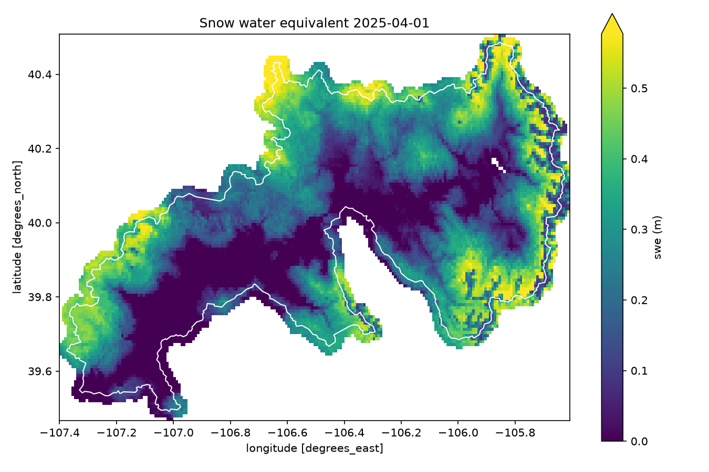

# snodas-tools

Download, convert, and summarize NOAA's **SNODAS** snow data for any watershed in the contiguous US.

[SNODAS](https://nsidc.org/data/g02158) (the Snow Data Assimilation System) is NOAA's daily, ~1 km model of the
snowpack across the US: snow water equivalent (SWE), snow depth, melt, sublimation, snowpack temperature and
precipitation, every day since 2003. It's free, but it ships as raw binary grids for the whole country. To answer a
question like *"how much water is sitting in the snowpack above my reservoir today?"* you have to download, decode,
georeference, clip and add it up yourself.

`snodas-tools` does that in one command:

```bash
snodas run --config my_basins.toml --recent 3
```

and gives you tidy daily tables (CSV, Parquet or Excel) of **snowpack volume and average depth for each of your basins**,
optionally broken down **by elevation band**.



## What it does

- **Downloads** daily SNODAS archives from NSIDC (in parallel, with retries; skips days you already have).
- **Converts** the raw `.dat` grids to compressed, georeferenced **NetCDF** or **GeoTIFF**, in real units (meters,
  kelvin), readable by xarray, QGIS, Panoply, GDAL, ArcGIS, etc. Optionally saves smaller copies clipped to your area.
- **Summarizes** each basin: average (inches or mm) and total volume (acre-feet or cubic meters), plus per elevation
  band using a DEM. Works anywhere in the SNODAS domain: areas are computed in an equal-area projection centered on each
  basin.
- **Fetches a DEM** for your basin from USGS 3DEP (free, no key) for the elevation bands.
- **Previews** data right in the terminal (a color map or a chart), as a PNG, or in an interactive window.
- **Uploads** results to S3 or any S3-compatible store (optional), and is happy running from cron.

## Install

Requires Python 3.11+.

```bash
pip install "snodas-tools[all] @ git+https://github.com/wheredoesyourmindgo/snodas-tools"
```

or with [uv](https://docs.astral.sh/uv/):

```bash
uv tool install "snodas-tools[all] @ git+https://github.com/wheredoesyourmindgo/snodas-tools"
```

The extras are optional: `parquet` (Parquet tables), `excel` (Excel tables), `plot` (PNG maps and windows, matplotlib),
`s3` (uploads, boto3). `all` installs every one. Pin a release with `@v0.1.0` at the end of the URL.

## Quick start

Everything below works without a config file. Data goes to `./snodas_data` and tables to `./snodas_output` unless you
say otherwise (`--dir`, `--output`).

**1. Download a day** (a ~45 MB archive with every product):

```bash
snodas download 2025-04-01
```

**2. Convert it** (only the products you care about):

```bash
snodas convert 2025-04-01 --products swe depth
```

**3. Look at it:**

```bash
snodas info snodas_data/2025/04/01/masked/us_ssmv11034tS__T0001TTNATS2025040105HP001.nc
snodas preview snodas_data/2025/04/01/masked/us_ssmv11034tS__T0001TTNATS2025040105HP001.nc --basin my_basin.geojson
```

**4. Summarize your basin** (any GeoJSON, shapefile, GeoPackage, or zipped shapefile):

```bash
snodas stats 2025-04-01 --basin upper_river=my_basin.geojson
cat snodas_output/swe_sum.csv
```

```
date,upper_river
2025-04-01,1248453.82
```

**5. Do a whole season and chart it:**

```bash
snodas download --start 2024-10-01 --end 2025-07-31
snodas convert  --start 2024-10-01 --end 2025-07-31 --products swe --delete-raw
snodas stats    --start 2024-10-01 --end 2025-07-31 --basin upper_river=my_basin.geojson --products swe
snodas chart snodas_output/swe_sum.csv
```

Date options work the same for every command: a single `DATE`, `--start` (and optionally `--end`, default today), or
`--recent N` for the last N days. `--timezone America/Denver` controls what "today" means (default UTC).

## Config files and scheduled runs

For anything you'll run more than once, put your settings in a TOML file and use `snodas run`, which downloads,
converts, computes statistics, and optionally uploads and cleans up. See the fully commented
[`examples/config.example.toml`](examples/config.example.toml). A minimal one:

```toml
[data]
directory = "snodas_data"
timezone = "America/Denver"

[convert]
products = ["swe", "depth", "melt", "temp"]
keep_raw = false              # delete the .dat files once converted

[stats]
output_directory = "snodas_output"
export_formats = ["csv", "parquet"]

[[basin]]
name = "upper_river"
shapes = ["basins/upper_river.geojson"]

[[basin]]
name = "lower_river"
shapes = ["basins/lower_a.shp", "basins/lower_b.shp"]   # several shapes are merged into one basin
  [basin.elevation_bands]
  dem = "dem/lower_river.tif"   # create with: snodas dem basins/lower_a.shp basins/lower_b.shp -o dem/lower_river.tif
  step = 500
  units = "ft"
```

```bash
snodas run --config my_basins.toml --recent 3
```

`run` doesn't re-download days whose outputs already exist (pass `--overwrite` to force it) but always recomputes their
statistics, so re-running a date updates its row. It exits non-zero if any download fails, which makes it easy to
monitor. A daily cron job (`--recent 3` re-checks the last few days, so a day NSIDC publishes late is picked up on the next run):

```cron
0 8 * * * cd /srv/snow && /srv/snow/.venv/bin/snodas run -c my_basins.toml --recent 3 >> snodas.log 2>&1
```

Progress bars switch off automatically when output isn't a terminal.

### Clip regions

If you don't need the whole continent, have `convert` save a clipped copy for your area and point basins at it. It
saves a lot of disk (tens of KB per product per day for a watershed, instead of ~1-3 MB for the continent):

```toml
[convert]
keep_full_extent = false

[[convert.clip]]
name = "my_area"
shapes = ["basins/upper_river.geojson", "basins/lower_a.shp"]
buffer_m = 1000        # include cells within 1 km of the edge
interpolate = false    # fill missing cells (lakes) by linear interpolation
upscale = 1            # resample to N times finer resolution (bilinear)

[[basin]]
name = "upper_river"
shapes = ["basins/upper_river.geojson"]
source = "my_area"     # read from the clipped copy
```

### Uploading results

```toml
[upload]
bucket = "my-bucket"
prefix = "snodas"                                  # tables go to snodas/stats/, grids to snodas/grids/
endpoint_url = "https://nyc3.digitaloceanspaces.com"   # leave out for AWS S3
public = false
rasters = false
```

Credentials come from the standard `AWS_ACCESS_KEY_ID` / `AWS_SECRET_ACCESS_KEY` environment variables (or
`~/.aws/credentials`).

## Commands

| Command | What it does |
|---|---|
| `snodas download` | Download and unpack days from NSIDC (`--workers`, `--overwrite`, `--unmasked`) |
| `snodas convert` | `.dat` to NetCDF/GeoTIFF (`--format`, `--products`, `--clip NAME=SHAPE`, `--delete-raw`) |
| `snodas stats` | Basin statistics (`--basin NAME=SHAPE`, `--products`, `--units`, `--export csv parquet xlsx`) |
| `snodas run` | Everything above, from a config file |
| `snodas dem` | Download a DEM for a basin from USGS 3DEP |
| `snodas info` | Summarize a converted grid (size, bounds, units, min/mean/max) |
| `snodas preview` | Draw a grid in the terminal, save a PNG (`--png`), or open a window (`--show`) |
| `snodas chart` | Chart a statistics table in the terminal |
| `snodas products` | List the SNODAS products |

Every command has `--help`. Commands that read data also take `--config` to use a config file's settings (command-line
flags win).

## Output

`snodas stats` / `snodas run` keep one table per product and statistic in the output folder, updated in place:

| File | Rows | Columns | Units (imperial / metric) |
|---|---|---|---|
| `swe_sum.csv` | date | one per basin | acre-feet / m³ |
| `swe_avg.csv` | date | one per basin | inches / mm |
| `swe_sum_elevation.csv` | date, basin | one per elevation band, e.g. `7000-8000` | acre-feet / m³ |
| `swe_avg_elevation.csv` | date, basin | one per elevation band | inches / mm |
| `temp_avg.csv` | date | one per basin | °F, °C or K |
| `units.json` | | units of every table | |

...and likewise for `depth`, `melt`, `sublimation`, `sublimation_blowing`, `precip_liquid`, `precip_solid`. Parquet and
Excel copies are written alongside when requested. Temperature has no `sum`.

Converted grids live next to the downloads: `snodas_data/YYYY/MM/DD/masked/<SNODAS name>.nc`, and clipped copies as
`<SNODAS name>_<region>.nc`.

## Looking at the data

### In the terminal

```console
$ snodas info snodas_data/2025/04/01/masked/us_ssmv11034tS__T0001TTNATS2025040105HP001_upper_colorado.nc
        name: swe
 description: Snow water equivalent
       units: m
        date: 2025-04-01
        size: 216 x 125 cells
  resolution: 0.008333 x 0.008333 degrees
      bounds: W -107.4000, S 39.4667, E -105.6000, N 40.5083
         crs: EPSG:4326
 valid cells: 13,986 of 27,000
         min: 0
        mean: 0.222
         max: 0.914
```

`snodas preview FILE` draws the grid in color with half-block characters (two cells per character). Add `--basin` to
zoom in, `--width` to size it, and `--no-color` for plain text:

```console
$ snodas preview ...upper_colorado.nc --basin examples/basins/colorado_headwaters.geojson --no-color --width 60
Snow water equivalent 2025-04-01
                        @@@%#*+=+ ## @%     =++#*%=##%+.
                       @@@%%#*++*#@@@@%#*##*+++#*#%=+#=+=%
                       @@%##*++=+**##**+++++==+##%*--+#*+=#
                       #%#*+**=:-===-+=-:-=--=****=:.:+*#=:-
                    ++=*%%#*==:.  .:..:-=+**+=: .    .+*+=:*
            =-::..--------====-:              .    .:-++**=:
        @@@%#--:..::::---------.            .-:   ..:-+#%%=:
   %%%%##*+=:                 . ==   .:--:::-=+#@#++===*#=@
 %#%#*-.::.       ....      .-++**#      ::=+=*#+#+*@%@#-#%
...
low '.' 0 ... high '@' 0.578 m
```

`snodas chart TABLE` charts a statistics table:

```console
$ snodas chart snodas_output/swe_sum.csv --height 6
swe_sum: colorado_headwaters
1,393,062 │█▇▅▄▂▂▂▃
          │████████
          │████████
          │████████
          │████████
        0 │████████
          └────────
           2025-03-25 2025-04-01
           units: acre-ft
```

### Other command-line tools

The converted files are standard NetCDF4/GeoTIFF, so the usual tools work:

```bash
gdalinfo -stats grid.nc                  # GDAL: georeferencing and statistics
ncdump -h grid.nc                        # netCDF: header, variables and attributes
gdal_translate grid.nc grid.tif          # convert formats
gdalwarp -t_srs EPSG:5070 grid.nc albers.tif   # reproject
cdo info grid.nc                         # Climate Data Operators
```

To glance at a PNG: `snodas preview grid.nc --png map.png`, then `open map.png` (macOS; or `qlmanage -p map.png` for
Quick Look), `xdg-open map.png` (Linux), or `start map.png` (Windows).

### In Python

```python
import xarray as xr
import pandas as pd

swe = xr.open_dataset("snodas_data/2025/04/01/masked/us_ssmv11034tS__T0001TTNATS2025040105HP001.nc").swe  # meters
swe.sel(lon=slice(-107.4, -105.6), lat=slice(40.5, 39.5)).plot(robust=True)

table = pd.read_csv("snodas_output/swe_sum.csv", parse_dates=["date"], index_col="date")
table.plot(ylabel="acre-feet")
```

`snodas preview FILE --show` opens an interactive matplotlib window (zoom, pan, read values). In Jupyter,
[hvplot](https://hvplot.holoviz.org/) (with geoviews) gives interactive maps over a basemap:
`swe.hvplot(geo=True, tiles="OSM")`.

The package has a Python API too; see [`examples/explore.py`](examples/explore.py):

```python
from snodas_tools import Basin, Units, basin_stats, convert, download, get_product, resolve_dates
from snodas_tools.pipeline import find_raster

days = resolve_dates(start="2025-03-25", end="2025-04-01")
download(days, "snodas_data")
convert(days, "snodas_data", products=[get_product("swe")])

basin = Basin("my_basin", ["my_basin.geojson"])
for day in days:
    grid = find_raster(day, "snodas_data", True, get_product("swe"), None)
    print(day, basin_stats(grid, basin, get_product("swe"), day, Units("imperial")).values)
```

### Desktop apps

- [QGIS](https://qgis.org) (free): drag in a `.nc` or `.tif` and your basin shapefile. Use *Layer Properties >
  Symbology > Singleband pseudocolor* for a color ramp, and the *Identify* tool to read values.
- [Panoply](https://www.giss.nasa.gov/tools/panoply/) (free, NASA): opens the NetCDF files directly and makes quick maps.
- ArcGIS Pro: *Add Data* opens both formats.

## How the numbers are computed

- **Grid.** SNODAS is a 30 arc-second (1/120°, roughly 0.7 x 0.9 km in the mid-latitudes) WGS84 grid. Grids are placed
  using NSIDC's published corner coordinates, with cell values at cell centers.
- **Basin cells.** A cell belongs to a basin when its center is inside the basin outline.
- **Missing cells.** SNODAS has no value over large lakes and a few other cells. By default, missing cells inside a
  basin are filled by linear interpolation from their neighbors (`interpolate = false` on a basin turns this off).
- **Snow-free cells.** SNODAS leaves melt and sublimation blank wherever there's no snowpack; those cells count as 0.
  Snowpack temperature is also blank where there's no snow, and its average covers only the snow-covered cells.
- **Average** is the mean of the basin's cells, converted to inches or millimeters (or °F/°C/K for temperature).
- **Volume** (`sum`) is that average depth times the basin's area. Areas are measured in a Lambert azimuthal
  equal-area projection centered on each basin, so they're accurate anywhere in the SNODAS domain.
- **Elevation bands.** The DEM is averaged onto the SNODAS grid, cells are grouped into bands (each band includes its
  upper edge), and each band's volume is its share of the basin volume, so the bands add up to the basin total.

## About SNODAS

| Product | Code | Raw scale | Notes |
|---|---|---|---|
| `swe` | 1034 | m × 1000 | Snow water equivalent |
| `depth` | 1036 | m × 1000 | Snow depth (snapshot) |
| `temp` | 1038 | K × 1 (newer files: K × 10) | Snowpack average temperature |
| `sublimation_blowing` | 1039 | m × 100000 | Blowing snow sublimation, 24-hour total |
| `melt` | 1044 | m × 100000 | Melt runoff at the base of the snowpack, 24-hour total |
| `sublimation` | 1050 | m × 100000 | Snowpack sublimation, 24-hour total |
| `precip_liquid` | 1025 (`lL00`) | kg/m² × 10 | Liquid precipitation, 24-hour total |
| `precip_solid` | 1025 (`lL01`) | kg/m² × 10 | Solid precipitation, 24-hour total |

- **Masked** data (the default) covers the contiguous US from 2003-09-30. **Unmasked** data (`--unmasked`, `masked = false`)
  covers a larger North American area from 2009-12-09.
- Snapshot products (SWE, depth, temperature) are the model state at 06:00 UTC on that date; the others are 24-hour totals.
- NSIDC moved the grid slightly on 2013-10-01; this is handled automatically.
- Each day's `.txt` metadata says how its values are scaled, and `convert` reads it, so encoding changes (such as
  snowpack temperature switching from kelvins to tenths of a kelvin in recent files) are handled automatically.
- Some days were never published. `snodas download` reports them as "not published" and carries on. Known gaps in the
  masked archive include 2007-02-14, 2007-03-26, 2008-03-13, 2008-06-13, 2008-06-18, 2009-08-20 and 2012-12-20,
  and individual products are missing on a handful of other days in 2003-2006.
- Details are in the [SNODAS user guide](https://nsidc.org/data/g02158).

### Citing SNODAS

If you publish results, please cite the data:

> National Operational Hydrologic Remote Sensing Center. 2004. *Snow Data Assimilation System (SNODAS) Data Products at
> NSIDC, Version 1.* Boulder, Colorado USA. NSIDC: National Snow and Ice Data Center. https://doi.org/10.7265/N5TB14TC

## Development

```bash
git clone https://github.com/wheredoesyourmindgo/snodas-tools
cd snodas-tools
uv venv && uv pip install -e ".[dev]"
.venv/bin/pytest
```

The tests use small synthetic grids and never touch the network.

## License

[MIT](LICENSE). SNODAS data is produced by NOAA's National Operational Hydrologic Remote Sensing Center and distributed
by NSIDC; it is in the public domain. Basin boundaries in `examples/` are from the USGS Watershed Boundary Dataset
(public domain).
